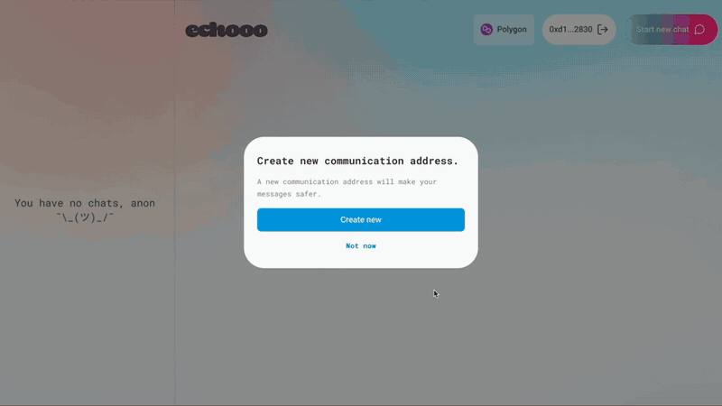

# Echooo

Private messaging on a public blockchain. Messages are encrypted to separate, rotatable *communication keys* instead of your wallet key, so a stolen wallet key doesn't expose your chat history.

**ETHNewYork 2022 winner:** Optimism "Just Deploy!" and Polygon "Top 10". See the [project page on ETHGlobal](https://ethglobal.com/showcase/echooo-messaging-protocol-h7oms).



*Forty seconds of the hackathon demo: create a communication address, start a chat, send and receive messages. [MP4 version](docs/echooo-demo.mp4) · [Full two-minute demo on ETHGlobal](https://ethglobal.com/showcase/echooo-messaging-protocol-h7oms). The demo shows the hackathon build; the code in this repo includes later work.*

## How it works

1. **Communication address.** The browser generates a fresh key pair that is separate from your wallet and publishes the public key on-chain through `Echo.logIdentity`. The private key stays in the browser's local storage.
2. **Sending.** The sender's client looks up the recipient's communication public key through the subgraph and encrypts the message twice with public-key encryption ([`eth-crypto`](https://github.com/pubkey/eth-crypto), ECIES): once to the sender's key and once to the recipient's, so both sides can read the conversation back. It then calls `Echo.logMessage` with both ciphertexts.
3. **No contract state.** `Echo.sol` keeps no storage. It only emits events (`IdentityEvent`, `MessageEvent`).
4. **Reading.** A [The Graph](https://thegraph.com) subgraph indexes those events. The recipient's client queries it and decrypts with their private communication key.
5. **Rotation.** Creating a new communication address publishes a new public key, so keys can be replaced whenever you want.

## Features

- Connect with MetaMask or WalletConnect, and start chats by address or ENS name
- Encrypted one-to-one chat
- Offers inside a chat: NFT swaps that can be accepted, cancelled or left to expire (`RequestNFT.sol`), token transfers (`TokenTransfer.sol`) and lending offers (`Lending.sol`, `LendingFactory.sol`)
- NFT profile pictures (`ProfilePicture.sol`)

## Screenshots


## Tech stack

| Layer | What it uses |
|---|---|
| Contracts | Solidity, Hardhat, OpenZeppelin, tests in TypeScript (Waffle, Chai) |
| Indexing | The Graph subgraph (mappings in `graph/src`), GraphQL |
| Frontend | React 18, Tailwind CSS, wagmi, ethers v5, urql, `eth-crypto`, Moralis API for NFT data |
| Networks | The code is configured for Polygon Mumbai, Avalanche Fuji and Goerli. The hackathon deployment targeted Polygon, Optimism, SKALE, Cronos and Boba. |

## Repository layout

```
contracts/   Echo (messaging events), RequestNFT, TokenTransfer, ProfilePicture, Lending
frontend/    React app
graph/       The Graph subgraph (schema, mappings, per-network config)
scripts/     Hardhat deploy scripts
test/        Contract tests
docs/        Demo clip
```

## Running it yourself

The hosted demo is offline and the original deployments targeted testnets that have since been retired, so running Echooo means deploying your own copies.

**Contracts**

```bash
npm install
npx hardhat compile
npx hardhat test
```

To deploy, put `PRIVATE_KEY_FUJI`, `PRIVATE_KEY_MATIC` or `PRIVATE_KEY_GOERLI` in a `.env` file and run:

```bash
npx hardhat run scripts/deployEchoMessaging.ts --network <network>
```

**Subgraph**

```bash
cd graph
npm install
npm run codegen
npm run deploy:<network>   # mumbai, fuji or goerli
```

The deploy scripts in `graph/package.json` point at the original team's Graph account, so change the account and subgraph name first.

**Frontend**

1. Put your contract addresses and subgraph URLs in `frontend/src/constants/constants.js`.
2. Create `frontend/.env` with `ALCHEMY_ID` and `REACT_APP_MORALIS_API_KEY`.
3. Run `npm install && npm start` inside `frontend/` and open http://localhost:3000.

## Status and limitations

- Echooo is a hackathon prototype. It has not been audited, so don't use it with real funds.
- Message contents are encrypted, but who messages whom, and when, is visible on-chain.
- Private communication keys live in the browser's local storage.
